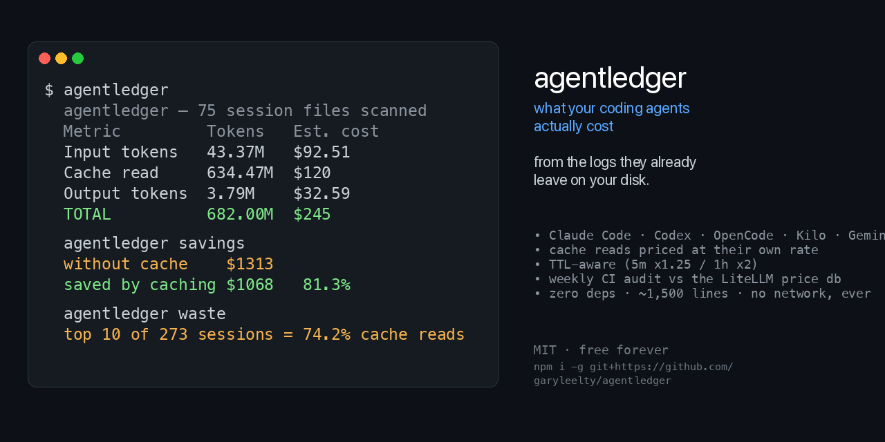

# agentledger



**What did that agent actually cost you?**

`agentledger-cli` is a local-first ledger for AI coding agents. It reads the
session logs that Claude Code, Codex, OpenCode, Kilo, DSH, and Gemini CLI
already write to your machine and turns them into tokens and dollars.

```
$ agentledger

  agentledger — 119 session files scanned

  Metric         Tokens   Est. cost
  ─────────────  ───────  ─────────
  Input tokens   244.32M  $608
  Cache read     1.81B    $315
  Cache write    366.4k   $0.0842
  Output tokens  7.03M    $63.62
  TOTAL          2.06B    $987

  Agent        Tokens   Est. cost  Records
  ───────────  ───────  ─────────  ───────
  dsh          1.38B  $782       4577
  codex        219.45M  $193       3053
  opencode     246.32M  $25.42     3772
  claude-code  205.05M  $2.24     3531
  kilo         3.32M    $0.3186    103

  ! 8 model(s) have no built-in price and used the
    $3/$15 per-Mtok default ($775 of the total):
      hy4-preview  (1491 records)
      step-5-preview  (988 records)
      ...
    Fix in one step: `agentledger prices --template` prints a
    fill-in override file for exactly these models.
```

*(That is a real run on the machine it was written on — including the warning,
which is the point of it. Most of that total is placeholder-priced, and the
tool says so rather than letting you quote it.)*

## Why

If you pay per token for your agents, your bill is a lagging indicator. By the
time you see it you have already spent it. `agentledger-cli` gives you the number
while you are still working:

- **Local only.** It reads `~/.claude/projects`, `~/.codex/sessions`,
  `~/.local/share/opencode`, and `~/.gemini/tmp`. Nothing is uploaded, no
  account, no API key, no network call of any kind.
- **Cache buckets are priced separately.** Cache reads and cache writes bill at
  different rates from fresh input, and they are the majority of real traffic —
  631M of the 678M tokens in my own logs are cache reads.
- **Fast.** A full scan of ~180M tokens of logs takes about a second.
- **Boring dependencies.** Node 22.5+ and the standard library. That's it.

- **Cost attribution.** Codex records the working directory and branch in
  `session_meta`; Claude Code records `cwd` and `gitBranch`; OpenCode's store
  joins messages to sessions. `by-project` and `by-branch` price each of those
  separately, so you can see what a feature branch actually cost rather than
  only what a model cost. Grouping is lossless — per-project costs sum back to
  the grand total, and a test asserts it.

- **Waste you can act on.** Cache reads dominate real agent traffic — 631M of
  678M tokens on the machine this was written on. `waste` ranks sessions by
  cache-read volume and states what share the top few hold, which points at
  context churn (a long session re-sending its prefix, or a tool returning
  large output every turn) rather than at "usage went up".

### Honest comparison

[ccusage](https://github.com/ccusage/ccusage) is the incumbent and it covers
far more agents than this (18 adapters against our 6). It reports reasoning
token **counts** but does not bill them in the OpenCode or Kilo lanes — on the
kilo store `sum(reasoning)` is 133 tokens and ccusage's output total is
`sum(output)` alone, 39,597 against agentledger's 39,730 — and its statusline
shows 5-hour billing blocks and burn rate. Its pricing also comes from LiteLLM's database, embedded at build
time from a locked revision. If you want the most complete tool, use that
one. What we share now: TTL-split cache writes, a statusline that prefers
the host's own session cost over any estimate, and per-model overrides.

Where this differs, as far as I can tell: agentledger's table is a checked-in
static file that a CI job reconciles against **live** LiteLLM weekly — a stale
entry fails a build on a schedule instead of waiting for a manual
`update-litellm-pricing`; `savings` prices the counterfactual (what the same
ledger would have cost with no prompt caching); and the whole tool is ~2,100
lines of zero-dependency JavaScript with no build step, no runtime fetch, and
no network call of any kind.

**One source ccusage cannot read at all.** ccusage has 18 adapters
and **no `dsh` adapter** — `ccusage dsh` returns `Unknown command`. `crosscheck`
reports this automatically rather than trusting prose:

```
  ONLY DSH (DeepSeek Harness) — 1091363048 tokens, $843.38 (ccusage has no adapter)
```

DSH
(DeepSeek Harness) keeps multi-frame zstd sessions at
`~/.dsh/sessions/*/session.v4.jsonl.zstd`; on this machine that is 46 sessions
and ~1.1B tokens, more than every other agent combined. Caveat stated plainly:
most DSH models reach it through gateways with no canonical public price, so a
large share of that lane is placeholder-priced and the report says so. The
token *counts* are real; the dollars in that lane are estimates until you set
real rates with `--prices`.

**Reasoning tokens are billed as output.** OpenCode records them in a separate
`tokens.reasoning` field; verified on this machine that `total = input +
output + reasoning + cache.read + cache.write` holds for all 2,176 rows that
have reasoning, so they are additive and bill at the output rate. (Codex is
the opposite: its `output_tokens` already includes reasoning, and adding the
field again double-counted 244,601 tokens. Both cases are pinned by tests.
ccusage excludes reasoning from OpenCode's output bucket, so it reports lower
output there — 1,220,552 against agentledger's 1,695,212 for the same model.)

**Measured against ccusage on the same machine** (ccusage 20.0.34, darwin
arm64, run against the same `~/.claude/projects`, `~/.codex/sessions` and
`opencode.db`): token counts agree exactly for codex (219,388,883) and
opencode (240,912,255), and for Claude Code after the fix below
(in=2,373,420 / out=511,342 / cache read=202,163,520 for the largest model).
That head-to-head is also how a real bug surfaced: Claude Code re-emits the
same assistant message (resumed sessions, sidechain replays, retries) and this
tool was summing every row — 2,861 rows for 1,260 distinct message ids, a 2.2x
over-count that reported $15.67 for a lane costing ~$2.21. It now deduplicates
on `message.id` with ccusage's rule (prefer non-sidechain, then more tokens).
Where the totals still differ it is pricing, not counting: `mimo-v2.5-pro` has
no canonical LiteLLM entry (only reseller rows that disagree with each other),
so this tool's rate for it is an estimate and ccusage's is a different one.

agentledger exists because I wanted something I could read end to end.
Whether that trade is worth it is your call, not mine.

It still makes no network call of any kind — no telemetry, no update check, no
pricing fetch. The one thing it does ask of the runtime is `node:sqlite`, which
is part of Node itself.

## Install

From a release tarball (no npm account, no registry, no build step):

```bash
npm install -g https://github.com/garyleelty/agentledger/releases/download/v0.3.0/agentledger-cli-0.3.0.tgz
```

The tarball is attached to each release by the release workflow using the
repo's own token, so this path works whether or not the package is on the
registry. Verified: installed from that URL and ran `agentledger --version`.

Or with npm, straight from the repository:

```bash
npm install -g git+https://github.com/garyleelty/agentledger.git   # install
npx --package=git+https://github.com/garyleelty/agentledger.git agentledger  # run once
```

All of these give you `agentledger` and `aledger`.

Or one line, with no npm involvement at all:

```bash
curl -fsSL https://raw.githubusercontent.com/garyleelty/agentledger/main/install.sh | sh
```

That clones into `~/.agentledger` and symlinks `agentledger` (and the shorter
`aledger`) into `~/.local/bin`, printing the `PATH` line to add if
`~/.local/bin` is not already on yours. Upgrade with
`git -C ~/.agentledger pull`, or just re-run the installer.

Or run it straight from a clone, no install step at all:

```bash
git clone https://github.com/garyleelty/agentledger.git && cd agentledger
node bin/agentledger.js
```

> **The registry package is not published yet.** `npx agentledger-cli` fails
> with a 404 because `agentledger-cli` is not on npm; publishing still needs a
> token with 2FA bypass. The `git+https` form above is the way to install
> through npm until that lands. This README will lead with `npx agentledger-cli`
> once the package is actually there.

Requires **Node 22.5+** — the OpenCode lane reads a SQLite database and
`node:sqlite`'s `DatabaseSync` landed in 22.5.

## Usage

```bash
agentledger-cli summary         # totals + per-agent breakdown (also the default with no args)
agentledger-cli sources         # which sources have data on this machine
agentledger-cli by-project      # cost per repository / working directory
agentledger-cli by-branch       # cost per git branch
agentledger-cli waste           # where the cache-read spend is concentrated
agentledger-cli savings         # what prompt caching saved, priced against no cache
agentledger-cli by-model        # which model is eating your budget
agentledger-cli by-day -d 30    # daily spend curve
agentledger-cli sessions -n 20  # most expensive sessions
agentledger-cli budget -b 100   # spend against a limit
agentledger-cli statusline      # one line for Claude Code's status bar
agentledger-cli watch           # live totals, refreshes every 5s
agentledger-cli prices          # the built-in pricing table
agentledger-cli aggregate       # shareable totals + groupings, no session ids
agentledger-cli json            # machine-readable dump
```

### Budget

Every other command reports what already happened. `budget` is the one that
answers the question you actually have while working — am I about to go over:

```
$ agentledger budget -b 100

  budget    $100
  spent     $966   ████████████████████████  966.4%
  remaining $0.0000   OVER by $866

  run rate  $5.06/day  over 191.2 days of activity
            already $866 over.
```

The run rate is measured over the span of data you actually have, not a
calendar period: a ledger that covers three months but was only used for two
days should not report a three-month run rate. `--json` emits the same numbers
plus the window, which is the shape a statusline or a CI gate wants:

```bash
agentledger budget -b 100 --json | jq '{spent: .spentUSD, over: .over, perDay: .runRateUSDPerDay}'
```

An overrun is reported as `over: true` with `daysUntilRunOut: null`, rather
than a misleading projection.

### Statusline

`statusline` is for Claude Code's status bar. Add to `~/.claude/settings.json`:

```json
{
  "statusLine": {
    "type": "command",
    "command": "agentledger statusline",
    "padding": 0
  }
}
```

Claude Code pipes it a JSON payload on every render. When the payload carries
the session's own cost (current versions do), agentledger echoes that number —
the host's own measurement beats any estimate, and no files are read, so the
bar never stutters. On older payloads it prices just the session's transcript
file, not the whole ledger. It always exits 0 and prints exactly one line: a
statusline that can break your prompt bar is a statusline you delete, so the
degradation paths are tested as hard as the happy one (82 tests, 6 of them
this contract).

### Savings

`budget` tells you what you spent. This tells you what prompt caching saved,
by pricing the same records as though every cache-read token had been billed
at its model's fresh-input rate:

```
$ agentledger savings

  What prompt caching saved

  paid                  $987
  without cache        $3819
  saved                $2832   74.2% cheaper

  [██████████████████████░░░░░░░░]  74.2% saved

  1.32B of 1.54B tokens came from cache
  (93.1% of the total).
```

That is the theorem behind the whole tool: cache reads are the overwhelming
majority of agent traffic, they bill at a fraction of the input rate, and a
tool that does not price them separately is wrong by an order of magnitude.
`savings` is the same arithmetic run backwards — and the reason a cache-aware
budget matters more than an invoice.

Counted per model at that model's own rates, with no provider-level averaging.

Two JSON shapes, deliberately:

| Command | Use it for | Contents |
| --- | --- | --- |
| `aggregate` | sharing, CI, a digest | totals + per-agent and per-model groupings |
| `json` | debugging, spreadsheets | one row per usage record, **including session ids** |

`json` is the debugging shape. On Claude Code and Codex the session id is a
UUID that names a real log file under the agent's own directory, so a report
built from it publishes a map of your projects. Use `aggregate` for anything
that leaves your machine:

```bash
agentledger-cli aggregate > spend.json     # ~3 kB
agentledger-cli json        > records.json  # one row per record, much larger
```

Useful flags:

| Flag | Meaning |
| --- | --- |
| `-a, --agent <name>` | only one agent (`claude-code`, `codex`, `opencode`, `kilo`, `dsh`, `gemini-cli`) |
| `-p, --path <dir>` | also scan a directory or single file |
| `--since <date>` | only records at/after a date |
| `-n, --top <n>` | rows in ranked reports |
| `--prices <file>` | override prices from a JSON map (see below) |
| `--json` | JSON instead of a table |

Examples:

```bash
# What did today's Claude Code session cost?
agentledger-cli -a claude-code --since "$(date +%F)" by-day

# Export everything for a spreadsheet
agentledger-cli json > ledger.json

# Pipe into a status line / CI check
agentledger-cli json | jq '.totals.costUSD'
```

### Custom prices (`--prices`)

Every number this tool prints is a list price. If you pay something else —
a negotiated rate, a proxy lane, a regional price — bring your own:

```bash
# my-prices.json — partial entries merge over the built-in row,
# so overriding `input` never resets output or the cache multipliers.
{
  "gpt-5.5": { "input": 4.0, "output": 24.0 },
  "minimax-cn/MiniMax-M2.7": { "input": 0.25, "output": 1.0 },
  "my-gateway-model": { "input": 0.5, "output": 1.5 }
}

agentledger --prices my-prices.json           # any report
agentledger prices --prices my-prices.json    # the table, overrides marked *
```

Overrides win over everything, including the `-free`/`:free` zero-lane rule:
if you name a model explicitly, you meant it. A bad file fails the run with
a clear message — a half-applied price file would still print an
authoritative-looking table, which is the one outcome this feature must
never produce.

Don't want to write the file by hand? Ask for it:

```bash
agentledger prices --template > prices.json   # only the unpriced models, blank
$EDITOR prices.json                           # fill in your rates
agentledger --prices prices.json
```

The template names exactly the models in *your* ledger that fell back to the
default, each with its record count and token volume, so you can see what a
blank line is worth before you go looking up rates.

## Supported agents

| Agent | Logs read | Status |
| --- | --- | --- |
| Claude Code | `~/.claude/projects/**/*.jsonl` | ✅ |
| Codex CLI | `~/.codex/sessions/**/rollout-*.jsonl` | ✅ |
| OpenCode | `~/.local/share/opencode/opencode.db` | ✅ |
| Kilo | `~/.local/share/kilo/kilo.db` | ✅ |
| DSH (DeepSeek Harness) | `~/.dsh/sessions/*/session.v4.jsonl.zstd` | ✅ |
| Gemini CLI | `~/.gemini/tmp/**/logs.json` | ✅ |
| Anything else | `--path` + format sniffing | partial |

`agentledger sources` tells you which of those are actually present on your
machine, so an empty lane is never mistaken for a wrong path:

```
$ agentledger sources
  Agent        Log location             Here        Docs
  claude-code  ~/.claude/projects       62 file(s)  https://docs.claude.com/...
  codex        ~/.codex/sessions        11 file(s)  https://github.com/openai/codex
  opencode     ~/.local/share/opencode  1 file(s)   https://opencode.ai/docs
  kilo         ~/.local/share/kilo      1 file(s)   https://kilo.ai
  gemini-cli   ~/.gemini/tmp            not found   https://github.com/google-gemini/...

  4 of 5 sources have data on this machine.
```

`agentledger-cli sources` prints this table with links.

OpenCode is the one supported agent whose store is a SQLite database rather
than append-only text. It is opened read-only — a running OpenCode is never
blocked — and a locked or foreign database is skipped exactly the way a
truncated log line is.

## How costs are calculated

Each parser extracts raw token counts, then
[`src/pricing.js`](src/pricing.js) prices them:

```
cost = input            × in-price
     + cacheRead        × in-price × cacheReadMultiplier
     + cacheWrite       × in-price × cacheWriteMultiplier
     + output           × out-price
```

Prices are USD per 1M tokens, snapshotting the public pricing pages. They are
baked into the package so the tool works offline and stays deterministic.
Override a model by editing `PRICING` in `src/pricing.js` — it is a plain
object.

Costs are **estimates**. They do not include subscription plans (Claude Pro /
Max, ChatGPT Plus), discounts, negotiated rates, or taxes. For API-billed usage
they are normally within a few percent.

## Verifying the numbers

Two tools exist to check the tool against the world rather than against
itself. Both are in `tools/` and both run offline.

```bash
python3 tools/audit_pricing.py /path/to/litellm.json   # prices vs LiteLLM
node tools/crosscheck.mjs --ccusage /path/to/ccusage   # totals vs ccusage
```

**`audit_pricing.py`** diffs every built-in price against the authoritative
LiteLLM model database and exits non-zero on disagreement. It runs weekly in
CI. Its first run caught 7 wrong entries in this table, including an absolute
price pasted into a *multiplier* field (gpt-5: cached reads overstated 25%).

**`crosscheck.mjs`** runs agentledger and ccusage against the same logs and
diffs token buckets and cost per lane. This is what found four real bugs that
no amount of internal testing surfaced:

| bug | what it did |
| --- | --- |
| duplicate Claude messages | 2,861 rows for 1,260 message ids — 2.2x over-count |
| MiMo cache multiplier | 0.1x where LiteLLM says ~0.008x — 12x overcharge |
| codex reasoning | `output_tokens` already includes reasoning; adding it double-counted 244,601 tokens |
| codex baseline | first `token_count` is real usage, not zero — 108,711 tokens dropped |

Token buckets must agree exactly (they are counted facts); cost is allowed a
tolerance because two tools estimating models with no canonical price will
legitimately differ.

Neither tool is a substitute for thinking, but "the suite is green" only proves
a program is consistent with itself. Comparing against an independent
implementation is what actually finds bugs.

## Privacy

`agentledger-cli` opens your log files in read mode and writes nothing. There is
no telemetry, no update check, and no code path that can reach the network. You
can verify this in a few minutes — the whole tool is ~2,100 lines with zero
dependencies.

## Contributing

Issues and PRs welcome, especially:

- parsers for other agents (Cursor, Aider, Continue, Amp, …)
- more accurate pricing tables
- a statusline snippet for your shell of choice

## Support

agentledger is MIT-licensed and free forever. If it saved you a surprise bill,
you can send something directly — no account, no signup, no intermediary:

```
ETH  0xB30a208B84814D3F7091Bb779f2b0225288349aE
BTC  1EKTrfpKc7fQwNYUv4oHLa2cna6NqDq3sM
```

Check whether anything has arrived (queries public endpoints, read-only):

```bash
python3 tools/tip.py
```

There is no paid tier, no license key and no ads. Tipping is the only way this
project makes money, and it is entirely optional.

These addresses are not just pasted here — `python3 tools/prove_control.py`
re-derives both from the private key and produces an ECDSA signature that
verifies against the derived public key, so you can confirm they really are
the project's before sending anything.

## License

[MIT](LICENSE).

